 

---

## 👋 About Me

I'm a **Master's student in Applied Data Science and AI** at SRH University Heidelberg (thesis phase, graduating 03/2027). I build applied AI systems (agentic workflows, RAG and LLM pipelines), and I check carefully whether they actually work, with benchmarks against ground truth and honest baselines.

Before this, I spent two years as a **System Engineer at Merck Group (Sigma-Aldrich)**, supporting infrastructure for 60,000 users and the global Passkey MFA rollout.

- 🔬 Currently working on: my Master's thesis on graph learning for Metal-Organic Framework property prediction (see below), plus ML for drug discovery (blood-brain barrier and P-gp prediction with RDKit, ChemBERTa and PyTorch)
- 🌱 Currently learning: Model Context Protocol (MCP), Polars
- 🗣️ Languages: English (C1), German (A2, improving), Kannada, Hindi
- 📍 Based in Heidelberg, Germany, open to relocation

---

## 🎓 Master's Thesis (in progress)

**Language-Model-Enriched Graph Learning with Black Hole Sparsification for Metal-Organic Framework Property Prediction**
 M.Sc. Applied Data Science and Analytics, SRH University Heidelberg · Thesis exposé submitted September 2026

My earlier MOFQuantumNet case study found that simple Random Forest and k-NN baselines beat every GNN, because the similarity graph was built from information already in each node's features. The thesis tests whether a graph built from genuinely **different** information can change that.

- **Core idea:** build the graph from frozen ChemBERTa embeddings of each MOF's linker SMILES (MolT5 as a secondary comparison), instead of fingerprints alone.
- **Target and data:** Pore Limiting Diameter (PLD) on a 14,296-MOF dataset, using GCN and GraphSAGE.
- **Sparsification:** tests whether Black Hole graph pruning at 30% and 50% keeps performance on the new graphs, compared with random and k-center sampling.
- **Method:** keeps the leakage-free evaluation protocol from the case study, and treats a second negative result as a valid scientific answer.

**Tech:** PyTorch Geometric, ChemBERTa, RDKit, scikit-learn, FastAPI

---

## 🏆 Achievements and Certifications

**📄 Published research**
- **CitePrism: Human-in-the-Loop AI for Citation Auditing and Editorial Integrity**, arXiv preprint, May 2026, [arXiv:2605.16000](https://arxiv.org/abs/2605.16000)

**🎓 Certifications**
- NVIDIA: *Building LLM Applications with Prompt Engineering* (2025)
- NVIDIA: *Fundamentals of Deep Learning* (2025)
- *Creating Agentic AI Solutions with Microsoft Foundry*
- *Hands-On AI: Building AI Agents with Model Context Protocol (MCP) and Agent2Agent (A2A)*
- *Adding Knowledge to LLMs*

**🎓 Education**
- M.Sc. Applied Data Science and AI, SRH University Heidelberg (04/2025 – 03/2027, expected)
- B.E. Computer Science and Engineering, ATME College of Engineering, Mysuru (2018 – 2022)

---

## 🚀 Selected Projects

| Project | What it does | Tech |
|---|---|---|
| **[CitePrism](https://arxiv.org/abs/2605.16000)** *LLM citation auditing, co-authored paper* | Automates slow, manual reference verification. A four-tier retrieval fallback with source-grounded prompting stops the model from fabricating citations. Benchmarked against expert labels on 20 papers (Cohen's Kappa 0.429, moderate agreement). | Gemini, Llama-3.1, embeddings, Python |
| **[MOFQuantumNet](https://gowrikamahesh17.github.io)** *Molecular property prediction* | Audited and reimplemented a GNN pipeline for metal-organic framework properties. Fixed data leakage and test-set reuse, and showed that simple Random Forest and k-NN baselines beat every GNN. Includes a FastAPI console for non-technical users and a 23-page case study. | RDKit, SMILES, PyTorch Geometric, FastAPI |
| **[AI CEO](https://gowrikamahesh17.github.io)** *Strategic intelligence agent (university project)* | Weekly research-monitoring agent that extracts and summarizes 200+ articles from live sources into structured output. Streamlit UI shows the agent's reasoning steps, with automatic failover between LLM providers. | Gemini, Llama-3.1, Hugging Face, Streamlit |

**Also built:** a responsible-AI healthcare agent (SHAP, LIME, Fairlearn; HIPAA, GDPR and EU AI Act grounding), a multi-agent RAG system for policy documents, and a serverless GCP data pipeline (PySpark, dbt, BigQuery).

👉 More details on my [portfolio](https://gowrikamahesh17.github.io).

---

## 🛠️ My Stack

**Generative and Agentic AI** 

**Machine Learning** 

**Scientific and Chemical Data** 

**Data and Platforms** 

**Tools and Workflow** 

---

## 📊 GitHub Stats

 

  

  

Live data pulled from my GitHub account by third-party services (public contributions only).

---

